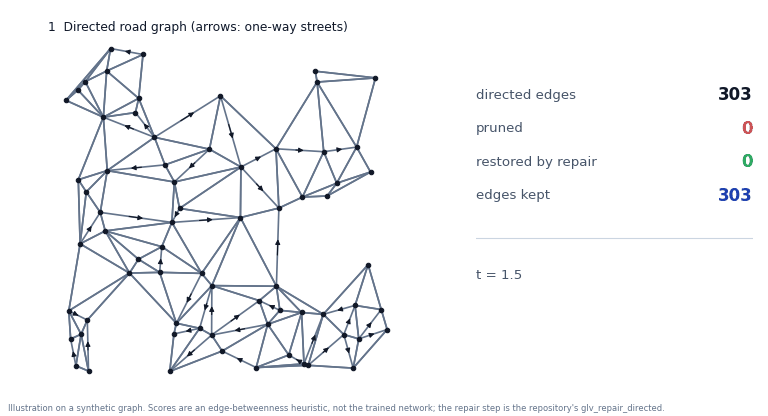
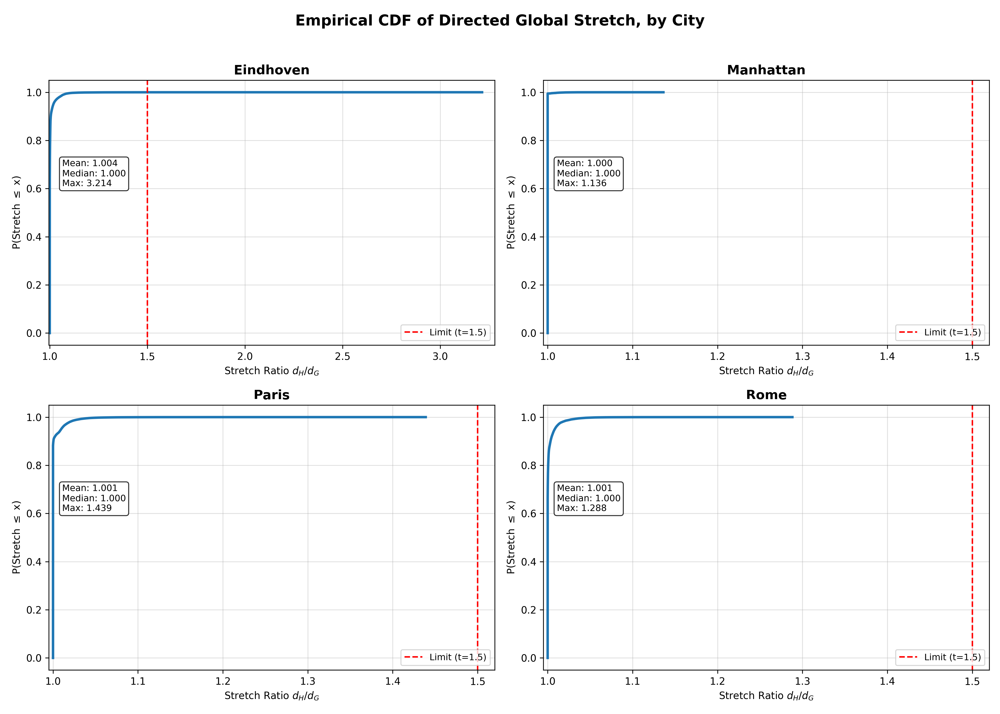
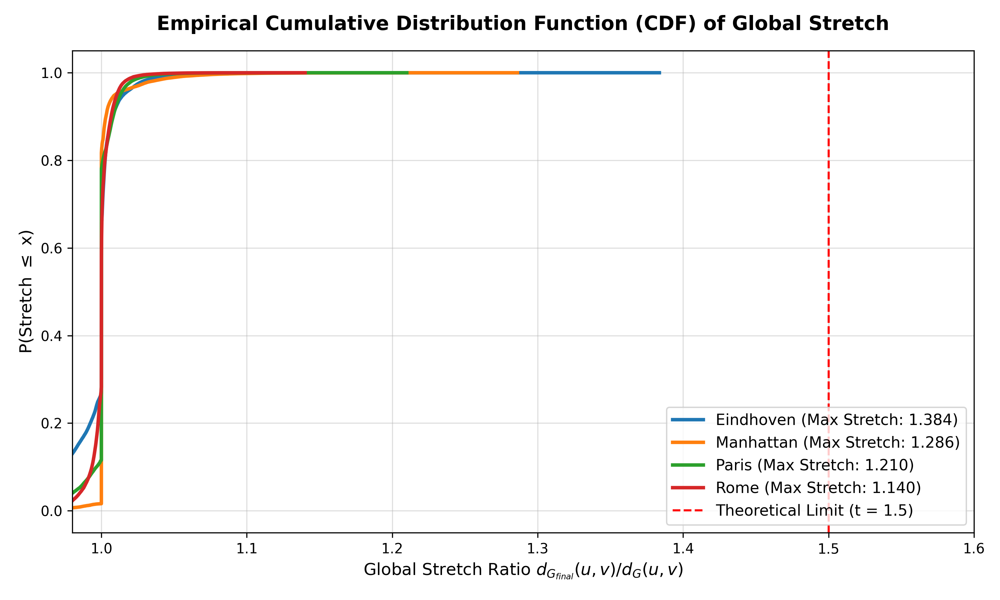
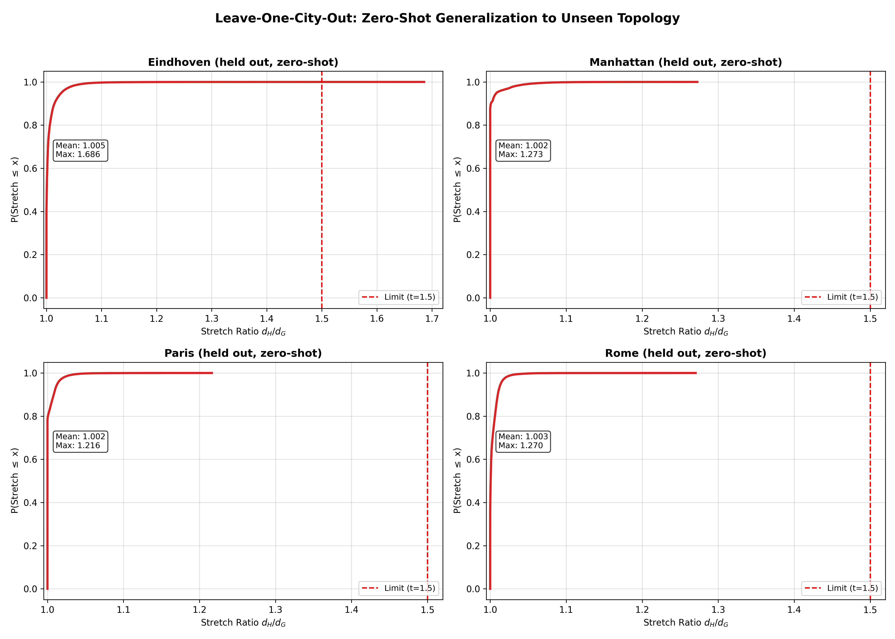
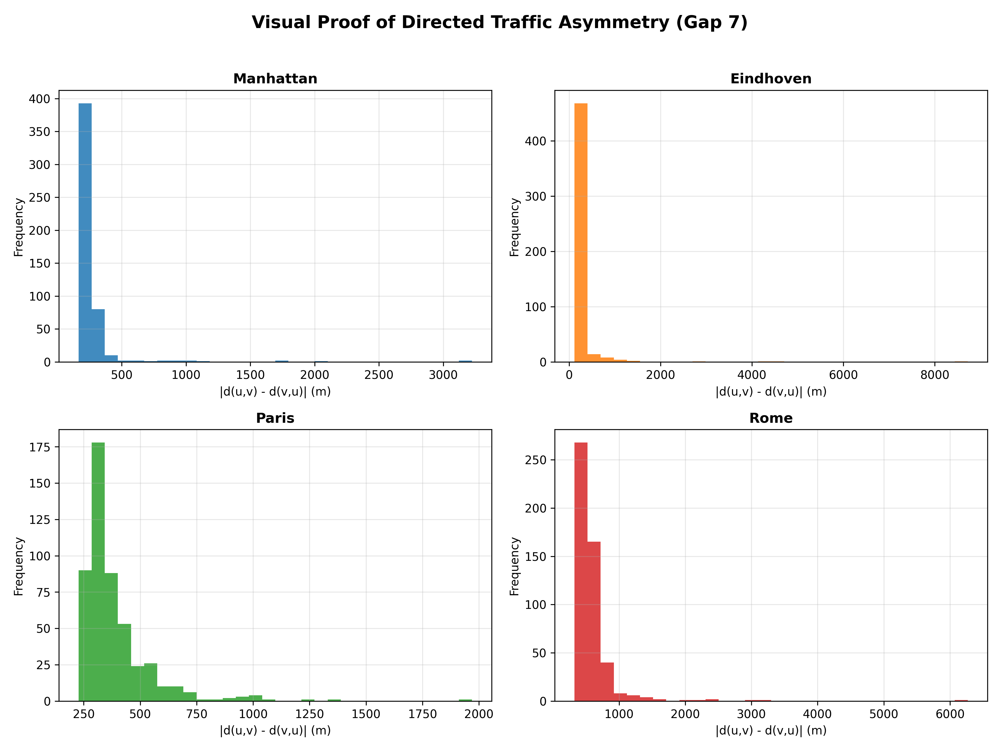
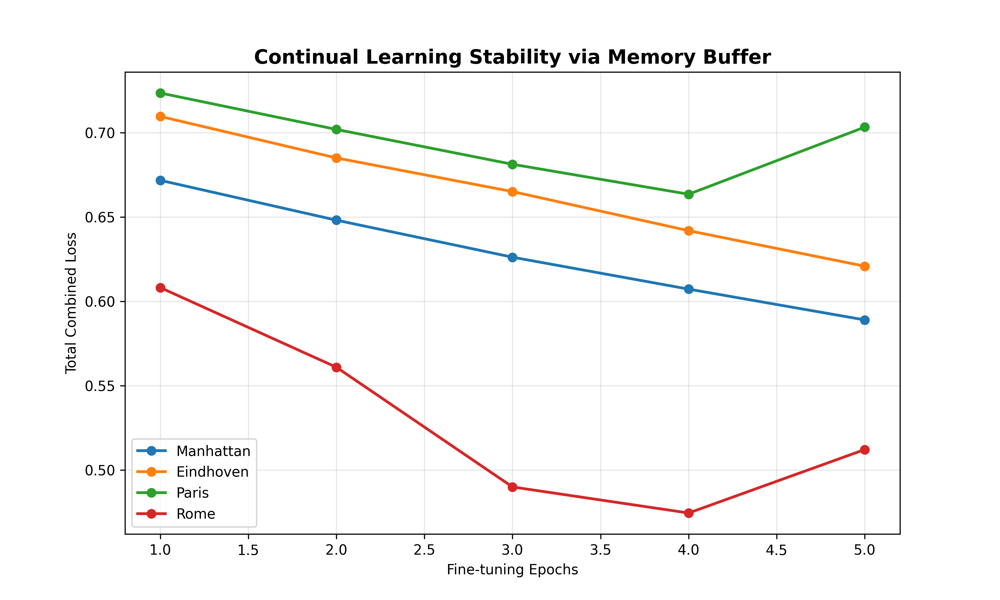

# Geo-SmartSpanner: Learned Edge Pruning for Directed Road-Network Spanners

<p align="center">
  <a href="https://github.com/soheylfalahzade/Research_Geometric_ML_Optimization/actions/workflows/tests.yml"></a>
  
  
  
  
</p>

<p align="center">
  
</p>

<p align="center"><sub>Mechanics of the pipeline on a small synthetic directed graph. The repair step is this repository's own <code>glv_repair_directed</code>; the pruning scores here are an edge-betweenness heuristic, not the trained network. Regenerate with <code>python make_animation.py</code>.</sub></p>

> Every number in the tables below is generated from the raw files in `results/raw_runs/` by `benchmarks/render_readme_tables.py`, and a test checks that `README.md` matches them. Nothing is estimated or typed by hand.

**Author:** Soheil Fallahzadeh — M.Sc. Student, Algorithms & Computational Geometry, Yazd University

## Contents

[Summary](#summary) | [Method](#method) | [Results](#results) | [Limitations](#limitations) | [Methodology notes](#methodology-notes) | [Reproducibility](#reproducibility) | [Research program](#research-program) | [Quickstart](#quickstart)

## Summary

Exact greedy $t$-spanner construction costs $O(m\,(n + m \log n))$, which is slow for metropolitan road networks. This repository studies a hybrid pipeline for **directed** road graphs:

1. a graph neural network with Monte Carlo Dropout predicts each edge's survival probability and its uncertainty;
2. a pruning decision turns the scores into a removal set, either by a calibrated threshold or by a fuzzy rule that combines model probability with edge betweenness;
3. a directed repair step restores every removed edge whose own endpoints would otherwise be further than $t$ times the edge length apart;
4. the result is verified by exhaustive or Monte Carlo stretch measurement on ordered pairs, and by strong-connectivity checks.

<!-- BEGIN:glance -->
| Quantity | Result |
| --- | --- |
| Construction speed-up over classic greedy | 7.6x to 34.6x on 4 cities (4,540 to 42,846 nodes) |
| Strong connectivity | preserved in every benchmark run |
| Pairs above the stretch bound, in-distribution (10⁵ per city) | none above 1.5 in 3 of 4 cities; Eindhoven: 0.0110% |
| Pairs above the stretch bound, leave-one-city-out | none above 1.5 in 3 of 4 cities; Eindhoven: 0.0040% |
| Pruning decision, fewest repairs | GA-tuned threshold with feedback (C), then fuzzy (E), then random (D), in every paired seed |
<!-- END:glance -->

The stretch guarantee of step 3 is **local**: it holds for each removed edge, not provably for every pair of nodes. Measured on $10^5$ pairs per city it held in three of four cities; see [Limitations](#limitations).

A negative result is also reported: evolutionary search shows no measurable advantage over random search when tuning a single threshold; the genetic algorithm is useful here for tuning several parameters jointly.

## Method


Directed stretch of a pair is $d_S(u,v) / d_G(u,v)$ with both distances measured along edge direction; a spanner subgraph can never have stretch below 1. Nodes are protected from being pruned below a live in/out degree of 2 (`MIN_SAFE_DEGREE`).

The fuzzy decision uses two normalized inputs, calibrated model probability $p$ and edge betweenness $c$, with five rules: high $p$ keep; medium $p$ and high $c$ keep; medium $p$ and low $c$ prune; low $p$ and high $c$ keep; low $p$ and low $c$ prune. It is implemented with plain numpy (no fuzzy-logic library).

## Results

### Construction speed against classic greedy

<!-- BEGIN:speedup -->
| City | Nodes | Edges | Greedy time (s) | Our time (s) | Speedup | Edges removed | Worst stretch | Strongly connected |
| --- | --- | --- | --- | --- | --- | --- | --- | --- |
| Manhattan | 4,540 | 9,756 | 0.850 | 0.112 ± 0.014 | **7.56x** | 0.24% | 1.4971 | yes |
| Eindhoven | 7,896 | 19,087 | 1.955 | 0.207 ± 0.013 | **9.43x** | 3.05% | 24.3820 | yes |
| Paris | 9,230 | 17,872 | 2.944 | 0.253 ± 0.063 | **11.65x** | 0.58% | 2.0195 | yes |
| Rome | 42,846 | 88,650 | 49.509 | 1.429 ± 0.069 | **34.65x** | 1.22% | 13.1275 | yes |
Source: `results/raw_runs/full_benchmark_20261029_083345.csv` (mean over 5 seeds; ± is the standard deviation of the construction time). Sparsification is the fraction of edges removed in the final graph; the speedup is obtained at a modest sparsification level. The classic greedy baseline is measured once per city. The worst stretch is the maximum over sampled source nodes and exceeds 1.5 in 3 of 4 cities (Eindhoven: 24.38, Paris: 2.02, Rome: 13.13); the repair guarantee is local, see Limitations.
<!-- END:speedup -->

### Comparison of three pruning-decision mechanisms

C prunes with a per-city genetic-algorithm-tuned threshold followed by one round of feedback fine-tuning on repaired edges; D prunes the same number of edges uniformly at random; E uses the fuzzy rule. All three remove exactly the same number of edges per seed, so the comparison isolates the quality of the decision.

<!-- BEGIN:pruning -->
| City | Seeds | C: GA-tuned threshold + feedback | D: random pruning | E: fuzzy pruning |
| --- | --- | --- | --- | --- |
| Eindhoven | 15 | **1175.9 ± 11.2** | 1515.3 ± 14.1 | 1320.5 ± 10.7 |
| Paris | 15 | **2680.3 ± 7.6** | 2774.0 ± 12.1 | 2722.5 ± 10.3 |
| Rome | 18 | **8416.3 ± 26.4** | 9195.9 ± 29.1 | 8779.8 ± 46.5 |

Table values are the number of repairs needed after pruning (lower is better). Sparsification is identical across the three variants for every seed.

| City | Comparison | Fewer repairs (first vs second) | Seeds in favour | Cohen's d_z (first minus second) | Wilcoxon p | Holm-adjusted p |
| --- | --- | --- | --- | --- | --- | --- |
| Eindhoven | C vs E | 11.0% | 15/15 | -14.0 | 6.5e-04 | 3.9e-03 |
| Eindhoven | E vs D | 12.9% | 15/15 | -13.9 | 6.5e-04 | 3.9e-03 |
| Eindhoven | C vs D | 22.4% | 15/15 | -25.2 | 6.5e-04 | 3.9e-03 |
| Paris | C vs E | 1.6% | 15/15 | -7.8 | 6.5e-04 | 3.9e-03 |
| Paris | E vs D | 1.9% | 15/15 | -6.5 | 6.5e-04 | 3.9e-03 |
| Paris | C vs D | 3.4% | 15/15 | -13.2 | 6.5e-04 | 3.9e-03 |
| Rome | C vs E | 4.1% | 18/18 | -7.6 | 2.0e-04 | 1.4e-03 |
| Rome | E vs D | 4.5% | 18/18 | -8.7 | 7.6e-06 | 6.9e-05 |
| Rome | C vs D | 8.5% | 18/18 | -35.0 | 7.6e-06 | 6.9e-05 |

Paired by seed, two-sided Wilcoxon signed-rank test, Holm correction over all 9 comparisons. Source: `results/raw_runs/fuzzy_pruning_rebuilt.csv`.
<!-- END:pruning -->

The calibrated threshold with feedback (C) needs the fewest repairs, the fuzzy rule (E) is in between and beats random pruning (D) in every seed, so the fuzzy rule carries real signal beyond the sparsity level, but it does not outperform calibrated thresholding. This ranking is the corrected one; see the correction note under [Methodology notes](#methodology-notes).

### Stretch verification (in-distribution)

<!-- BEGIN:stretch -->
| City | Mean stretch | Median | 99th percentile | Max | Violation rate (> 1.5) |
| --- | --- | --- | --- | --- | --- |
| Manhattan | 1.0001 | 1.0000 | 1.0000 | 1.1363 | 0.0000% |
| Eindhoven | 1.0036 | 1.0000 | 1.0697 | 3.2139 | 0.0110% |
| Paris | 1.0013 | 1.0000 | 1.0291 | 1.4389 | 0.0000% |
| Rome | 1.0015 | 1.0000 | 1.0273 | 1.2882 | 0.0000% |

10⁵ sampled directed route pairs per city. Source: `results/raw_runs/mc_validator_final.log`.
<!-- END:stretch -->

<p align="center">
  
</p>

<p align="center">
  
</p>

### Zero-shot generalization: leave-one-city-out

The model is fine-tuned on three cities and evaluated on the fourth, rotating over all four. Entire cities are held out, which avoids the leakage inherent in edge-level cross-validation, so this is the primary generalization test.

<!-- BEGIN:loco -->
| Held-out city | Fine-tuned on | Mean stretch | Median | 99th percentile | Max | Violation rate (> 1.5) |
| --- | --- | --- | --- | --- | --- | --- |
| Eindhoven | Manhattan, Paris, Rome | 1.0053 | 1.0007 | 1.0627 | 1.6856 | 0.0040% |
| Manhattan | Eindhoven, Paris, Rome | 1.0019 | 1.0000 | 1.0487 | 1.2726 | 0.0000% |
| Paris | Eindhoven, Manhattan, Rome | 1.0022 | 1.0000 | 1.0296 | 1.2162 | 0.0000% |
| Rome | Eindhoven, Manhattan, Paris | 1.0034 | 1.0007 | 1.0277 | 1.2703 | 0.0000% |

One fine-tuning run per fold, 10⁵ sampled pairs on the held-out city. Source: `results/raw_runs/leave_one_city_out_results.csv`.
<!-- END:loco -->

Mean stretch is above 1 in every held-out city, as it must be for a spanner subgraph. No statistical comparison with cities seen during fine-tuning was made, so no claim of equivalence is made.

<p align="center">
  
</p>

### Directed asymmetry and continual-learning stability

<p align="center">
  
  
</p>

The asymmetry plot shows mean $|d(u,v) - d(v,u)|$ per city, computed on the transposed adjacency matrix. The continual-learning loss is current-city loss plus $0.5\times$ replay-buffer loss; Rome shows a temporary increase between epochs 4 and 5, plausible given the small replay buffer and short schedule, but not confirmed across multiple seeds.

### Ablation and random-pruning baseline

<!-- BEGIN:ablation -->
| City | Variant | Seeds | Edges removed before repair (% of edges) | Repairs | Repairs per removed edge |
| --- | --- | --- | --- | --- | --- |
| Manhattan | Full model (MC-Dropout + GA threshold + centrality) | 5 | 6.00 ± 0.04 | 562.4 ± 4.6 | 0.960 ± 0.002 |
| Manhattan | No MC-Dropout | 5 | 6.46 ± 0.00 | 606.0 ± 0.0 | 0.962 ± 0.000 |
| Manhattan | Untuned threshold 0.50 | 5 | 7.88 ± 0.06 | 745.4 ± 6.1 | 0.969 ± 0.001 |
| Manhattan | Random pruning, same number of removed edges | 5 | 6.00 ± 0.04 | 573.2 ± 2.4 | 0.979 ± 0.007 |
| Eindhoven | Full model (MC-Dropout + GA threshold + centrality) | 5 | 6.02 ± 0.02 | 771.8 ± 7.8 | 0.671 ± 0.004 |
| Eindhoven | No MC-Dropout | 5 | 6.77 ± 0.00 | 885.0 ± 0.0 | 0.684 ± 0.000 |
| Eindhoven | Untuned threshold 0.50 | 5 | 9.92 ± 0.02 | 1369.0 ± 5.1 | 0.723 ± 0.002 |
| Eindhoven | Random pruning, same number of removed edges | 5 | 6.02 ± 0.02 | 1023.2 ± 12.9 | 0.890 ± 0.010 |
| Paris | Full model (MC-Dropout + GA threshold + centrality) | 5 | 4.49 ± 0.01 | 736.4 ± 2.1 | 0.918 ± 0.001 |
| Paris | No MC-Dropout | 5 | 4.82 ± 0.00 | 794.0 ± 0.0 | 0.921 ± 0.000 |
| Paris | Untuned threshold 0.50 | 5 | 5.62 ± 0.03 | 931.6 ± 6.5 | 0.928 ± 0.001 |
| Paris | Random pruning, same number of removed edges | 5 | 4.49 ± 0.01 | 760.0 ± 4.1 | 0.947 ± 0.004 |
| Rome | Full model (MC-Dropout + GA threshold + centrality) | 5 | 5.47 ± 0.01 | 3997.6 ± 14.4 | 0.824 ± 0.001 |
| Rome | No MC-Dropout | 5 | 6.04 ± 0.00 | 4476.0 ± 0.0 | 0.836 ± 0.000 |
| Rome | Untuned threshold 0.50 | 5 | 7.97 ± 0.01 | 6123.8 ± 3.6 | 0.867 ± 0.001 |
| Rome | Random pruning, same number of removed edges | 5 | 5.47 ± 0.01 | 4456.4 ± 22.4 | 0.919 ± 0.003 |

Values are mean ± standard deviation over seeds; repairs are counted after pruning (lower is better). Random pruning removes exactly as many edges as the full model removed in the same seed, under the same degree safeguard. The full model needed fewer repairs than this baseline in 20 of 20 city-seed pairs (by city: Manhattan 5/5 (mean difference 10.8); Eindhoven 5/5 (mean difference 251.4); Paris 5/5 (mean difference 23.6); Rome 5/5 (mean difference 458.8); difference = random minus full). The other two variants remove more edges than the full model, so their repair counts are not directly comparable; the last column is a rate, not a test. No significance test is reported: there are 5 seeds per city, and the seeds of one city share the graph and the trained model. Sources: `ablation_baseline_20261029_154726.csv`, `ablation_baseline_20261029_154648.csv`, `ablation_baseline_20261029_154751.csv`, `ablation_baseline_20261029_154835.csv`.
<!-- END:ablation -->

How to read this table: the random baseline removes exactly as many edges as the full model removed in the same seed, under the same degree safeguard, so the repair counts of these two are comparable. The other two variants prune with the model but remove more edges, so their repair counts are not comparable. This run used the committed base-model weights (SHA-256 prefix `d772f259`). An earlier run (files `ablation_baseline_20261029_0838*` and `_083940`) used weights retrained inside the speed benchmark and a baseline that was not matched on the number of removed edges; in three of its four cities random pruning needed fewer repairs than the full model, the opposite of the present result. Both things changed at once, so which one explains the difference is not established. Those files stay in `results/raw_runs/` and are not used by any table.

### Edge-classifier cross-validation (supplementary)

Stratified 5-fold cross-validation of the edge classifier on the synthetic training set (about 89/11 class imbalance). Because edges share nodes, neighbouring edges can appear in both a training and a test fold, so this estimate is optimistic and is **not** used to support any generalization claim.

<!-- BEGIN:kfold -->
| Fold | AUC | F1 | Precision | Recall |
| --- | --- | --- | --- | --- |
| 1 | 0.7254 | 0.8748 | 0.9349 | 0.8219 |
| 2 | 0.7119 | 0.8631 | 0.9340 | 0.8022 |
| 3 | 0.7037 | 0.8772 | 0.9305 | 0.8296 |
| 4 | 0.7163 | 0.8963 | 0.9288 | 0.8660 |
| 5 | 0.7212 | 0.8900 | 0.9321 | 0.8516 |
| **mean ± std** | **0.7157 ± 0.0084** | **0.8803 ± 0.0131** | **0.9320 ± 0.0025** | **0.8343 ± 0.0250** |

Source: `results/raw_runs/stratified_kfold_results.csv`.
<!-- END:kfold -->

## Limitations

- **The repair guarantee is local.** The repair check verifies, for each removed edge, that its own endpoints remain within $t$ times that edge's original length. It does not check arbitrary source-destination pairs, and independently repaired regions can compound into a longer detour for a few unrelated pairs. In Eindhoven this appears as a small nonzero violation rate (in-distribution and leave-one-city-out). Classic greedy construction bounds every pair provably. Whether a global guarantee is required, and which repair would provide it, is an open design question.
- **Scale.** Zero-shot on Tokyo (437,623 nodes after SCC extraction, 831,958 edges) the output was valid (mean stretch 1.0010, maximum 1.3493, no violation over 218.8 million sampled pairs, byte-identical on a repeated run, see `results/raw_runs/tokyo_scale_test_verified.log`), but only 0.09% of edges (755) were pruned, so there is essentially no sparsification benefit at that scale. The edge-centrality feature and threshold were calibrated on graphs about two orders of magnitude smaller; retraining or recalibration on 400,000+ node cities has not been done.
- **Ablation.** Four cities, 5 seeds each, committed weights. Only the comparison with the random baseline that is matched on removed edges is interpretable; the other two variants remove more edges. No significance test is reported (5 seeds per city, shared graph and model within a city). The earlier unmatched run points the other way and is not used; the cause of the difference is not established.
- **Cities and seeds.** Four cities support a directional generalization claim, not a definitive one; leave-one-city-out has one run per fold.

## Methodology notes

<details>
<summary><b>Correction of the pruning-mechanism ranking (2026-08-24)</b></summary>

An earlier version of the pruning comparison reported the fuzzy mechanism (E) as the best performer. That was due to a sign bug in `mask_from_score_matched_count(-calibrated_C, ...)` for variant C, which caused the GA+Feedback method to prune the edges the model was MOST confident about keeping, rather than least. After fixing the sign, the corrected results show the opposite ranking. This was caught by tracing the scoring logic during an audit and is reported here rather than silently corrected.
</details>

<details>
<summary><b>Three measurement bugs found and fixed in the stretch validation</b></summary>

The independent Monte Carlo verification script (`monte_carlo_validator.py`) originally used `scipy.sparse.csgraph.dijkstra(..., directed=False)` and an undirected `nx.Graph()` for the pruned graph, both silently ignoring edge direction. This produced systematically biased stretch ratios (means below 1.0, which is mathematically impossible for a spanner subgraph). Fixed to `directed=True` and `nx.DiGraph()`.

A second, independent bug: `nx.adjacency_matrix()` sums parallel-edge weights on a `MultiDiGraph` instead of taking the minimum, which was artificially inflating "original graph" distances wherever OSM records a node pair as two or more parallel ways (see `safe_weighted_adjacency()` in `spanner_pipeline.py`).

A third issue: the bottleneck safeguard that prevents a node from being pruned down to near-isolation checked node degree against the **static original graph**, which never updates during the pruning loop. A node with 3 original outgoing edges could have all 3 independently pass the "don't isolate" check (each check saw the same unchanged degree of 3) and still be pruned down to a single remaining edge. Fixed by tracking each node's *live*, decreasing degree during the pruning loop and refusing to drop any node's out/in-degree below 2 (see `MIN_SAFE_DEGREE` in `spanner_pipeline.py` and `monte_carlo_validator.py`). This measurably improved several cities (for example Manhattan's maximum stretch dropped from 1.2861 to 1.1363).

All three have regression tests in `tests/test_core_algorithms.py`; each test fails when the corresponding bug is reintroduced.
</details>

<details>
<summary><b>Why the repair guarantee is local, in detail</b></summary>

`glv_repair_directed()`'s repair check (`_check_one_directed_edge`) only verifies that the two endpoints of a specific removed edge remain within `t_limit` times that edge's own original length of each other in the repaired graph. It does not check the stretch of arbitrary, unrelated (source, destination) pairs that happen to route through several independently repaired regions. Each local repair can individually pass its own check while the compounding effect of several nearby prunings still produces a longer-than-guaranteed detour for a small number of unrelated pairs. This is a local per-edge guarantee, not a global per-pair proof, which is the known distinction between heuristic or learned construction (fast, validated empirically by sampling) and classic greedy construction (slower, provably worst-case bounded for every pair).
</details>

<details>
<summary><b>Audit note on the directed-asymmetry computation</b></summary>

An earlier version re-ran Dijkstra from the same source on the forward distance array itself, which trivially produced a difference of about zero regardless of the graph's real asymmetry. It now computes reverse-direction distances on the transposed adjacency matrix (see `compute_global_stretch_scipy()` in `benchmarks/spanner_pipeline.py`); `tests/test_core_algorithms.py` guards against the regression.
</details>

## Reproducibility

| Check | How |
| --- | --- |
| Unit tests (directed repair, parallel edges, stretch measurement) | `pytest -q`; runs on every push without torch or network access |
| README tables match raw data | `python benchmarks/render_readme_tables.py --check` (also part of the test suite) |
| Regenerate the animation | `python make_animation.py` |
| Re-run the full benchmark | `python benchmarks/run_full_benchmark.py` (downloads the four city graphs; the speed-up table above uses the newest `full_benchmark_*.csv`) |
| Leave-one-city-out | `python benchmarks/leave_one_city_out.py` |

Raw result files and when they were produced (the live-degree safeguard and the parallel-edge fix were completed on 2026-08-29):

| Result | Source file | Run committed | Note |
| --- | --- | --- | --- |
| Stretch verification | `mc_validator_final.log` | 2026-08-29 | final pipeline |
| Leave-one-city-out | `leave_one_city_out_results.csv` | 2026-10-23 | final pipeline, one run per fold |
| Pruning-mechanism comparison | `fuzzy_pruning_rebuilt.csv` | 2026-08-24 | rebuilt after the sign correction |
| Speed benchmark | `full_benchmark_20261029_083345.csv` | 2026-10-29 | 5 seeds; model retrained inside the run; city graphs re-downloaded from OpenStreetMap, so sizes differ slightly from the 2026-07-06 run |
| Edge-classifier cross-validation | `stratified_kfold_results.csv` | 2026-10-29 | supplementary; edge-level folds leak, see above |
| Ablation | `ablation_baseline_20261029_1546*.csv` to `_154835.csv` (one per city) | 2026-10-29 | 5 seeds, 4 cities; committed weights; random baseline matched on removed-edge count |
| GA versus random search | `adaptive_ga_feedback_20260705_021416.csv` | 2026-07-05 | basis of the negative result in the Summary |

Seeds and random-number settings are fixed in the scripts; the MC-Dropout seed is pinned for the scale test.

## Research program

This repository is one component of a connected research program on emergency-aware urban network control. The four repositories share a problem family, not code: each is self-contained and makes claims only within its own tested scope.

| Repository | Setting | Role in the program | Type of guarantee |
| --- | --- | --- | --- |
| [`geometric-spanners-lab`](https://github.com/soheylfalahzade/geometric-spanners-lab) | Euclidean point sets, undirected | Classical greedy t-spanner baseline | Exact by construction; independently re-derived by `verify_independent.py` |
| **[`Research_Geometric_ML_Optimization`](https://github.com/soheylfalahzade/Research_Geometric_ML_Optimization) (this repository)** | Directed OpenStreetMap road graphs | Same spanner problem, with learned (GNN + fuzzy) edge pruning for speed | Per-edge local repair guarantee; global stretch validated empirically by Monte Carlo sampling (small nonzero violation rate in one city, disclosed in that repository's Limitations) |
| [`delay-bounded-spanner-networks`](https://github.com/soheylfalahzade/delay-bounded-spanner-networks) | Directed road graphs with hourly speed profiles | Same problem under a time-varying delay constraint | Certified: an edge-wise certificate implies the all-pairs, all-hours bound (Theorem 1); congestion model is parametric, not fitted to telemetry (its hourly shape was compared with measured speeds on two sensor graphs only) |
| [`anti-gridlock-signal-control`](https://github.com/soheylfalahzade/anti-gridlock-signal-control) | Signalized intersection and a three-junction corridor (SUMO) | Local control layer beneath a future network layer | Empirical (10 paired seeds per evaluation); no closed-loop stability proof |

Integration of the local control layer with the network layer is planned and has not been demonstrated. Open items per repository: the OpenStreetMap experiments in the lab repository use node coordinates only; the learned-pruning repository does not transfer to Tokyo scale (0.09% of edges pruned); the delay-bounded repository uses a parametric congestion field, compared with measured speeds only on two sensor graphs; the signal-control repository tests hand-set membership functions on at most three junctions.

## Quickstart

```bash
python3 -m venv venv && source venv/bin/activate
pip install -r requirements.txt

pytest -q                                   # unit tests, no GPU or network needed
python benchmarks/spanner_pipeline.py       # full benchmark suite across cities
python src/run_hybrid_test.py               # GNN + fuzzy pruning inference
```

## Project structure

```
Research_Geometric_ML_Optimization/
|-- benchmarks/        # pipeline, experiments, validators, README table renderer
|-- src/               # supporting modules (run_hybrid_test.py)
|-- tests/             # unit tests (torch-free core) and README consistency check
|-- results/
|   |-- data/          # datasets from OSMnx (input)
|   |-- figures/       # figures cited above plus other generated plots
|   |-- raw_runs/      # raw per-seed logs and CSVs: the source of every number above
|   `-- models/        # trained model weights
|-- logs/              # dataset-build console logs
|-- docs/              # interactive HTML maps
|-- make_animation.py  # illustration of the pipeline mechanics
|-- data_generator.py  # builds datasets from OSMnx, computes exact greedy ground truth
`-- requirements.txt
```

## License and citation

MIT License. Citation metadata is in [`CITATION.cff`](CITATION.cff).
